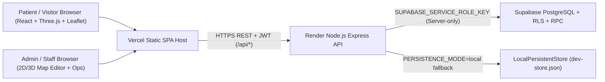

# MEDIPATH System Architecture

## Architectural Overview

MEDIPATH is structured as a strict three-workspace TypeScript monorepo sharing a single canonical spatial domain model (`@medipath/shared`). Sharing the exact types, coordinate conversions, Dijkstra shortest-path algorithm, and pre-publish graph connectivity validator between backend and frontend prevents client/server divergence.

## Workspace Responsibilities

### 1. `@medipath/shared`
- **`types.ts`**: Unified TypeScript interfaces for `Hospital`, `Building`, `Floor`, `Department`, `Destination`, `NavigationNode`, `NavigationEdge`, `QrCheckpoint`, `Doctor`, `DoctorSchedule`, `Appointment`, `QueueToken`, `HospitalServiceItem`, `ServiceRequest`, `Announcement`, `AuditLog`, and `MapVersion`.
- **`navigation.ts`**:
  - `svgTo3D` & `coords3DToSvg` mathematical bridge between `1000×640` SVG viewBox coordinates and `48m × 30m` Three.js pavilion coordinates.
  - `calculateShortestPath` bidirectional Dijkstra solver computing distances, walking durations, floor changes, and localized **English (`en`) / Tamil (`ta`)** instructions.
  - `validateNavigationGraph` verifying destination reachability, wheelchair/step-free connectivity, orphan nodes, and multi-floor connectedness before map publishing.
- **`sampleHospital.ts`**: Deterministic UUID v4 dataset for the four-floor fictional sample hospital (*Aurelia Pavilion Medical Center*).

### 2. `@medipath/backend`
- **Express 5 REST API**: Security headers via `helmet()`, strict dynamic CORS policy, JSON payload validation via `zod`, and bearer JWT verification.
- **Dual Persistence Adapter (`MediPathStore`)**:
  - **`SupabaseStore`**: Active automatically when valid `SUPABASE_URL` + `SUPABASE_SERVICE_ROLE_KEY` are supplied. Calls atomic `book_appointment_safe` PostgreSQL RPC to guarantee zero double-booking under concurrency.
  - **`LocalPersistentStore`**: File-backed JSON store (`backend/data/dev-store.json` or `:memory:` during Vitest runs) using `crypto.scryptSync` password hashing and matching RBAC guarantees for instant offline/local development.

### 3. `@medipath/frontend`
- **Public Portal**: Editorial ivory/deep-teal architectural design with Manrope, Inter, Playfair Display, and Noto Sans Tamil fonts. Lazy-loads Three.js / R3F bundle chunks cleanly (`vite.config.ts`) and renders `FloorPlan2DSVG` seamlessly whenever 2D mode is chosen or WebGL is absent.
- **Admin Operations Shell**: Guarded enterprise operations workspace with full CRUD across clinical resources, live queue counter progression, patient privacy separation, audit log inspection, and a live 2D+3D Map Editor.

## Security & Privacy Boundaries

1. **Zero Secret Leakage**: `SUPABASE_SERVICE_ROLE_KEY` and `DEV_JWT_SECRET` live strictly on the Express backend (`backend/src/config/env.ts`) and never appear in any frontend bundle or `VITE_*` variable.
2. **Double-Booking Prevention**: Enforced both at database index level (`appointments_no_double_booking_idx` partial unique index + PL/pgSQL row locking) and in `LocalPersistentStore`.
3. **Public Queue Anonymization**: Anonymous/public requests to `/api/queue` mask patient full names into initials (e.g., `"Priya Narayanan"` -> `"P. N."`).
4. **Restricted Corridor Protection**: `GET /api/navigation/graph` strips edges flagged `isRestricted: true` before returning public map graphs; Dijkstra strictly omits restricted edges for public routes.
5. **Indoor Positioning Honesty**: No fake Wi-Fi/BLE/GPS indoor coordinates are claimed anywhere in the UI or API; visitors anchor themselves cleanly via manual landmark dropdowns or scannable lobby QR checkpoints (`/qr/:code`).

